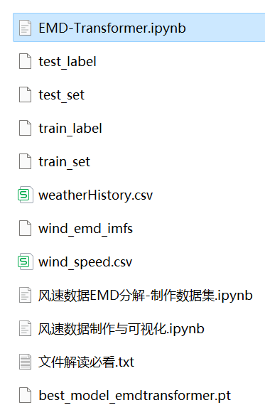
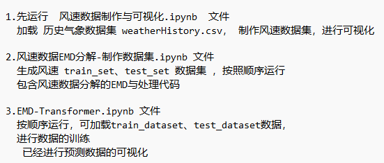
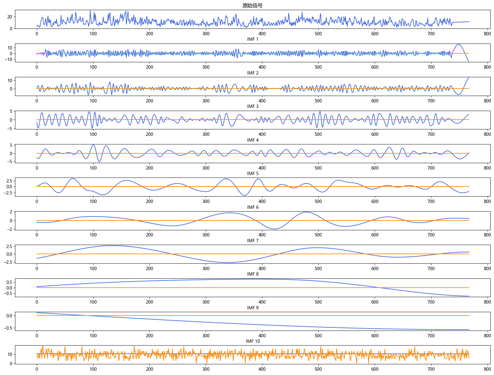

# Stepwise Wind Speed Prediction: EMD-Transformer Model

Multi-feature variables include the following:
1. Wind speed data, as well as wind speed datasets and label sets that have been generated and preprocessed using EMD decomposition, with corresponding code that can be run, and examples of EMD decomposition.
2. Transformer model parameters are less than one-tenth of those of LSTM, yet it achieves smaller MSE and MAE, showing significant performance.
3. Code for EMD preprocessing and EMD-Transformer prediction.
Environment: Python 3.9
(Platform displays fewer files than the images in the file explanation: The platform has a limit on the number of files uploaded; run the code according to the explanation, and the data can be generated based on the uploaded code)

## Images

<!-- PAYMENT_BLOCK -->

## Get this dataset

- Payment link (Stripe): [Buy now](https://buy.stripe.com/3cs8yP7sY87d0vu9AB)
- Payment QR code: 

<!-- /PAYMENT_BLOCK -->
